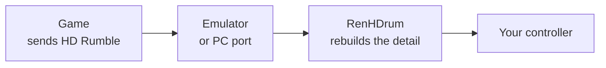
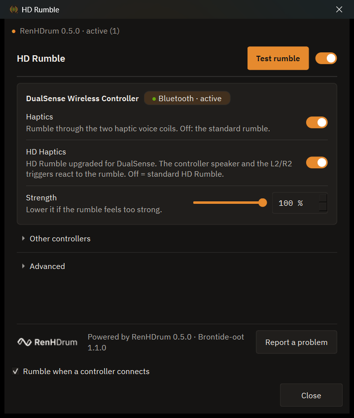
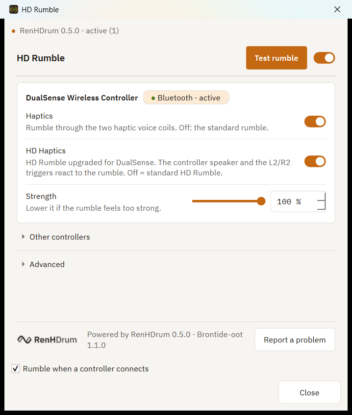

<p align="center"></p>

# RenHDrum

[](https://github.com/trzz1214/RenHDrum/actions/workflows/ci.yml)
[](NOTICE)
[](https://ryuhdr.threedola.workers.dev)

**Feel every note, click and texture a game puts into its vibration, on the controller you already own.**

Switch games don't just "buzz". They send detailed vibration called [HD Rumble](https://ryuhdr.threedola.workers.dev/compare.html): tiny notes, footsteps, clicks, rain. Most emulators flatten that into a plain rumble. RenHDrum is a small open-source engine that rebuilds the detail, every 5 ms, and plays it on a Pro Controller, a DualSense, an Xbox controller or a Steam Controller.



> [!TIP]
> **New to RenHDrum?** Read the **[Getting Started & FAQ guide](docs/GETTING-STARTED.md)** first.
>
> **Just want to play?** Ready-made test builds with RenHDrum already inside, for Switch 1, Switch 2 and recompiled PC ports, are all on the website.
>
> **[Get the builds &rarr;](https://ryuhdr.threedola.workers.dev/#download)**
>
> They are my personal experiments, not official releases. This repository contains no emulator binaries, games or keys.

## Supported controllers

| Controller | USB | Bluetooth | What you feel |
|---|:---:|:---:|---|
| Sony DualSense | ✅ | ✅ | **HD Haptics**: rumble, speaker and L2/R2 triggers together, on by default ([details](docs/integration/dualsense.md#6-hd-haptics-motors-speaker-and-triggers)) |
| Nintendo Switch Pro Controller | ✅ | ✅ | Full HD Rumble ([how Bluetooth is handled](docs/research/03-bluetooth-congestion-and-pacing.md)) |
| Xbox One / Series | ✅ | ✅ | HD Rumble [translated to four motors](docs/research/10-xbox-one-rumble.md) (tested on Xbox One S) |
| Steam Controller (2026) | ✅ | ✅ | Grips only, experimental |
| 🧪 Switch 2 Pro Controller (USB + Bluetooth, experimental) | 🧪 | 🧪 | HD Rumble 2 (USB in Brontide-NS2 & Longshot, and other recomp ports when their SDL3 has patch `0003` + libusb; Bluetooth in Brontide-NS2 only; close Steam completely; Windows 11 recommended) |

### HD Haptics on the DualSense

HD Haptics is HD Rumble upgraded for the DualSense. The game still only sends HD Rumble; RenHDrum splits it between the three parts of the controller, with one rule for every game:

- **Motors**, studio style: heavy hits and explosions sink to 75 Hz for a deeper thump.
- **Speaker**: taps by kind of sound (rain, gravel, metal) and stays quiet when the game plays music notes.
- **L2/R2 triggers**: kick back only while you hold them.

| | Wired | Bluetooth |
|---|:---:|:---:|
| Rumble | ✅ | ✅ |
| Triggers | ✅ | ✅ |
| Speaker | ✅ | ✅ |

DualSense over Bluetooth still gets rumble, speaker and triggers, with nothing extra to install: the speaker sound is compressed with Opus inside the controller report, and the encoder is built into `renhdrum.dll`. HD Haptics is on by default; turn it off in the HD Rumble settings to get exactly the previous DualSense rumble.

<p align="center">


</p>

Where it runs today: **Brontide-NS2**, **Brontide** (Switch 1), and **Longshot** are on the [website](https://ryuhdr.threedola.workers.dev/#download). **[dkb-pc-recomp](https://github.com/Lucas-blip-png/dkb-pc-recomp/releases)** and **[mkw-recomp](https://github.com/adriadam10/mkw-recomp/releases)** now include their own RenHDrum 0.5 bridge (`mkw-recomp` downloads `renhdrum.dll` **0.5.0** from its launcher; for `dkb-pc-recomp`, place [`renhdrum.dll` **0.5.0**](https://github.com/trzz1214/RenHDrum/releases/download/v0.5.0/renhdrum.dll) next to `dkb.exe` — `0.6.0` is rejected by the 0.5 bridge). **totk-pc-recomp** is currently being updated.

> [!NOTE]
> **🧪 Switch 2 Pro Controller (USB + Bluetooth, experimental)**: USB HD Rumble 2 is active in **Brontide-NS2** and **Longshot**, and in other recomp PC ports when their SDL3 includes patch `0003` + libusb; **Bluetooth** is currently only in **Brontide-NS2**. Close Steam completely before playing, and use **Windows 11** for Bluetooth if possible (Windows 10 Bluetooth writes take 50–60 ms, making rumble coarser). I do not own a Switch 2 Pro Controller, so I have not tested this on real hardware — if you have one, run **Test rumble** in Brontide-NS2, press **Copy report**, and paste it into the [controller test form](https://github.com/trzz1214/RenHDrum/issues/new?template=controller-test.yml).

Joy-Con 2, Steam Controller (2015) and Steam Deck are still in research, so please hold issues for them for now.

## Learn more

- **The story and the measurements**: the [website](https://ryuhdr.threedola.workers.dev) explains how HD Rumble works, in plain words.
- **The deep research**: [eleven write-ups](docs/research/README.md) on the packet format, the [5 ms envelope](docs/research/02-amfm-multisample-and-crisp-notes.md), [Switch 2 games](docs/research/11-switch2-hd-rumble.md) and more.

## For developers

RenHDrum is written in Rust (the Opus encoder for the DualSense speaker is built into the DLL, nothing extra to install) and exposes a small C ABI (`renhdrum.dll` + [`include/renhdrum.h`](include/renhdrum.h)), so any C, C++ or C# host can load it.

- Start here: [C++ / SDL3 host guide](docs/integration/sdl3-host.md) (the hook in 6 steps) or [C# host guide](docs/integration/csharp-host.md)
- Other hosts: [recompiled PC ports](docs/integration/recomp-games.md) · [Switch 2 games](docs/integration/switch2-games.md)
- Every function: [C ABI reference](docs/integration/c-abi-reference.md)

```bash
cargo test                 # all tests
cargo build --release      # renhdrum.dll / librenhdrum.so
```

### Where to find things

```text
RenHDrum/
├── src/            The engine (Rust)
├── include/        renhdrum.h, the C header hosts include
├── examples/       Minimal C and C# hosts
├── integrations/   Ready patches: SDL3, emulator hooks, recomp bridge
├── docs/
│   ├── integration/   How to add RenHDrum to a host
│   └── research/      How and why it works
└── tests/          Regression, golden waveform and guardrail tests
```

## Credits

RenHDrum exists thanks to people who measured, decoded and shared before me:

- **HD Rumble research**: [dekuNukem](https://github.com/dekuNukem/Nintendo_Switch_Reverse_Engineering), [Switchbrew](https://switchbrew.org/wiki/Joy-Con) contributors, rei-github, ClearlyClaire, [CTCaer](https://github.com/CTCaer/jc_toolkit), felipearmat
- **DualSense research**: [Nielk1](https://gist.github.com/Nielk1/6d54cc2c00d2201ccb8c2720ad7538db) and the DualSense community, [egormanga (SAxense)](https://github.com/egormanga/SAxense), [ragnarok179 (Enhanced-PS5-DualSense-Haptics-Bridge)](https://github.com/ragnarok179/Enhanced-PS5-DualSense-Haptics-Bridge) for the idea of the Bluetooth speaker report (ideas only, the code is my own)
- **Emulators and libraries**: the Ryujinx team, [Xiph.Org (libopus)](https://github.com/xiph/opus), Ryubing (GreemDev), Eden / yuzu contributors, [SDL](https://github.com/libsdl-org/SDL) (Sam Lantinga, Valve and contributors; zlib, including Switch 2 report format)
- **Switch 2 and PC ports**: neo Luigi (Eglantine), Franseven (PokeDinner), [samaBR85](https://github.com/samaBR85/renhdrum-eden), Frizti (Fritchii), **101Leafy** (`Frizti/Fritchii#6`, Switch 2 Pro frequency measurements on real hardware), **ndeadly** (`switch2_controller_research`), **BlueRetro** (`sw2.h` Switch 2 Pro report layout, Apache-2.0), **NS2Pro-Bridge-Windows** (MIT, 15 ms BLE pacing), zortos293 (Lichii), Dark (Dynamic FPS), [NotRexed (Hookshot)](https://github.com/NotRexed/Hookshot), [MagicBeanDev (Longshot)](https://git.magicbean.dev/MagicBeanDev), [adriadam10 (mkw-recomp)](https://github.com/adriadam10/mkw-recomp)

What each person contributed, and what was copied or only referenced: [docs/CREDITS.md](docs/CREDITS.md) and [`NOTICE`](NOTICE).

## Using RenHDrum in your project

You're welcome to. Keep the license notice, and a short credit is appreciated:

> HD Rumble by RenHDrum (Three-Dola), https://github.com/trzz1214/RenHDrum

Details for code, docs and citations: [how to credit](docs/CREDITS.md#reusing-renhdrum).

## License

Core: MIT OR Apache-2.0. Docs and website text: CC BY 4.0. Patches keep their upstream license (SDL3: zlib, emulator hooks: GPL-3.0-or-later). See [`NOTICE`](NOTICE).

<sub>Nintendo Switch, Joy-Con and Pro Controller are trademarks of Nintendo. PlayStation and DualSense are trademarks of Sony Interactive Entertainment. Xbox is a trademark of Microsoft. Steam is a trademark of Valve. RenHDrum is an independent research project, not affiliated with or endorsed by any of them.</sub>

---

<p align="center">
Built by Three-Dola with help from Claude and Gemini · <a href="https://ko-fi.com/threedola">Support on Ko-fi</a>
</p>

<details>
<summary>Other ways to support</summary>

- USDT (BEP20, BNB Smart Chain): `0x2fac84f94d05c550ed604f5867da62ac1bba7f7c`
- USDT (TRC20, Tron): `TAAEy72WPFAJ5h3g8GYFnZ7bm7CDnTuwTS`

</details>
