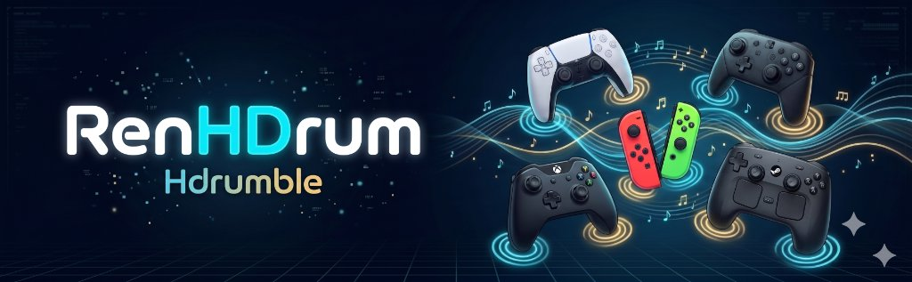
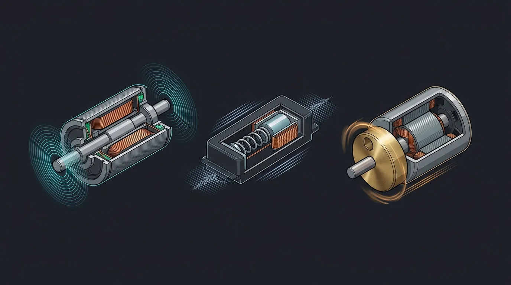

<p align="center"></p>

# RenHDrum

**I built RenHDrum to rebuild Switch HD Rumble every 5 ms and play every note, click, and texture on the controller you already own.**

[](https://github.com/trzz1214/RenHDrum/actions/workflows/ci.yml) [](NOTICE) [](https://ryuhdr.threedola.workers.dev)

**[New here? Read the overview](https://ryuhdr.threedola.workers.dev/overview.html)** · **[Get the builds](https://ryuhdr.threedola.workers.dev/#download)** · **[For developers](#for-developers)**

<p align="center"></p>
<p align="center"><sub>DualSense = voice coils (VCM), Pro Controller = linear resonant actuator (LRA), Xbox = spinning eccentric motors (ERM); each feels different, and I tuned RenHDrum to speak each one's language.</sub></p>

## Supported controllers

| Controller | USB | Bluetooth | What you feel |
|---|:---:|:---:|---|
| Sony DualSense | ✅ | ✅ | **HD Haptics**: motors, speaker, triggers ([details](docs/integration/dualsense.md#6-hd-haptics-motors-speaker-and-triggers)) |
| Nintendo Switch Pro Controller | ✅ | ✅ | Full HD Rumble ([Bluetooth pacing](docs/research/03-bluetooth-congestion-and-pacing.md)) |
| Xbox One / Series | ✅ | ✅ | HD Rumble [translated to four motors](docs/research/10-xbox-one-rumble.md) |
| Steam Controller (2026) | ✅ | ✅ | Grips only, experimental |
| 🧪 Switch 2 Pro Controller | 🧪 | 🧪 | Experimental, see [website](https://ryuhdr.threedola.workers.dev/pro2-controller.html); have one? [help test it](https://github.com/trzz1214/RenHDrum/issues/new?template=controller-test.yml) |

**HD Haptics on the DualSense** splits Switch HD Rumble across studio-tuned motors, speaker taps (via built-in Opus over Bluetooth), and L2/R2 trigger kicks — see [DualSense integration](docs/integration/dualsense.md#6-hd-haptics-motors-speaker-and-triggers).

**Where it runs:** **Brontide**, **Brontide-NS2**, **Longshot**, **dkb-pc-recomp**, and **mkw-recomp** — grab ready-made builds on the [website](https://ryuhdr.threedola.workers.dev/#download) or read the [Getting Started & FAQ guide](docs/GETTING-STARTED.md).

## For developers

RenHDrum is written in Rust (with the Opus encoder built into the DLL) and exposes a small C ABI (`renhdrum.dll` + [`include/renhdrum.h`](include/renhdrum.h)) so any C, C++, or C# host can load it.

- Start here: [C++ / SDL3 host guide](docs/integration/sdl3-host.md) or [C# host guide](docs/integration/csharp-host.md)
- Other hosts: [recompiled PC ports](docs/integration/recomp-games.md) · [Switch 2 games](docs/integration/switch2-games.md) · [C ABI reference](docs/integration/c-abi-reference.md) · [eleven research write-ups](docs/research/README.md)

```bash
cargo test                 # all tests
cargo build --release      # renhdrum.dll / librenhdrum.so
```

### Where to find things

```text
RenHDrum/
├── src/            The engine (Rust)
├── include/        renhdrum.h, the C header hosts include
├── examples/       Minimal C and C# hosts
├── integrations/   Ready patches: SDL3, emulator hooks, recomp bridge
├── docs/           Integration guides, research write-ups, and assets
└── tests/          Regression, golden waveform and guardrail tests
```

## Credits

RenHDrum exists thanks to people who measured, decoded and shared before me:

- **HD Rumble research**: [dekuNukem](https://github.com/dekuNukem/Nintendo_Switch_Reverse_Engineering), [Switchbrew](https://switchbrew.org/wiki/Joy-Con) contributors, rei-github, ClearlyClaire, [CTCaer](https://github.com/CTCaer/jc_toolkit), felipearmat
- **DualSense research**: [Nielk1](https://gist.github.com/Nielk1/6d54cc2c00d2201ccb8c2720ad7538db) and the DualSense community, [egormanga (SAxense)](https://github.com/egormanga/SAxense), [ragnarok179 (Enhanced-PS5-DualSense-Haptics-Bridge)](https://github.com/ragnarok179/Enhanced-PS5-DualSense-Haptics-Bridge) for the idea of the Bluetooth speaker report (ideas only, the code is my own)
- **Emulators and libraries**: the Ryujinx team, [Xiph.Org (libopus)](https://github.com/xiph/opus), Ryubing (GreemDev), Eden / yuzu contributors, [SDL](https://github.com/libsdl-org/SDL) (Sam Lantinga, Valve and contributors; zlib, including Switch 2 report format)
- **Switch 2 and PC ports**: neo Luigi (Eglantine), Franseven (PokeDinner), [samaBR85](https://github.com/samaBR85/renhdrum-eden), Frizti (Fritchii), **101Leafy** (`Frizti/Fritchii#6`, Switch 2 Pro frequency measurements on real hardware), **ndeadly** (`switch2_controller_research`), **BlueRetro** (`sw2.h` Switch 2 Pro report layout, Apache-2.0), **NS2Pro-Bridge-Windows** (MIT, 15 ms BLE pacing), zortos293 (Lichii), Dark (Dynamic FPS), [NotRexed (Hookshot)](https://github.com/NotRexed/Hookshot), [MagicBeanDev (Longshot)](https://git.magicbean.dev/MagicBeanDev), [adriadam10 (mkw-recomp)](https://github.com/adriadam10/mkw-recomp)

What each person contributed, and what was copied or only referenced: [docs/CREDITS.md](docs/CREDITS.md) and [`NOTICE`](NOTICE).

## Using RenHDrum in your project

You're welcome to. Keep the license notice, and a short credit is appreciated (`HD Rumble by RenHDrum (Three-Dola), https://github.com/trzz1214/RenHDrum`) — see [how to credit](docs/CREDITS.md#reusing-renhdrum).

## License

Core: MIT OR Apache-2.0. Docs and website text: CC BY 4.0. Patches keep their upstream license (SDL3: zlib, emulator hooks: GPL-3.0-or-later). See [`NOTICE`](NOTICE).

<sub>Nintendo Switch, Joy-Con and Pro Controller are trademarks of Nintendo. PlayStation and DualSense are trademarks of Sony Interactive Entertainment. Xbox is a trademark of Microsoft. Steam is a trademark of Valve. RenHDrum is an independent research project, not affiliated with or endorsed by any of them.</sub>

---

<p align="center">Built by Three-Dola with help from Claude and Gemini · <a href="https://ko-fi.com/threedola">Support on Ko-fi</a></p>
<details><summary>Other ways to support</summary>

- USDT (BEP20, BNB Smart Chain): `0x2fac84f94d05c550ed604f5867da62ac1bba7f7c`
- USDT (TRC20, Tron): `TAAEy72WPFAJ5h3g8GYFnZ7bm7CDnTuwTS`

</details>
