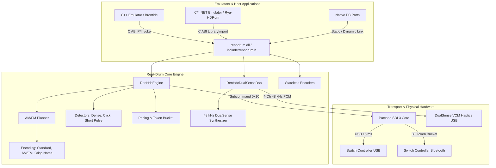

# RenHDrum Architecture & Module Layout

RenHDrum is an ultra-low-latency HD Rumble and DualSense audio haptics DSP engine implemented in safe Rust, exporting a zero-allocation C ABI.

---

## 1. System Architecture

---

## 2. Source Code Modules (`src/`)

| Module Path | Primary Responsibility |
|---|---|
| `src/lib.rs` | Root crate exports, public Rust API, re-exports for C FFI. |
| `src/ffi.rs` | C ABI implementation (`extern "C"`), null-safety bounds checking, zero-allocation wrappers. |
| `src/backend/nintendo_hd.rs` | Core stateful Nintendo Switch HD Rumble engine lifecycle and dispatch timing. |
| `src/planner/amfm_planner.rs` | 5 ms AM/FM multi-sample envelope planner and hardware envelope constraint validation. |
| `src/planner/amfm_measure.rs` | AM/FM pitch calibration, test pattern generators, and ladder measurements. |
| `src/encoding/standard.rs` | Standard dekuNukem 4-byte frequency and amplitude encoding table (101 thresholds). |
| `src/encoding/amfm.rs` | FormatThree (3x5-bit), FormatThree7bit (3x7-bit), and FormatTwo14bit bit-packing. |
| `src/encoding/crisp_notes.rs` | Crisp attack accentuation (+3 dB onset / -3 dB sustain decay). |
| `src/encoding/click.rs` | Nintendo hardware click pulse packet structures and classification. |
| `src/detectors/dense.rs` | High-density sample stream detector (250 ms rolling window, auto-slowdown trigger). |
| `src/detectors/click_detector.rs` | Transient pulse detector identifying isolated click candidates. |
| `src/detectors/short_pulse.rs` | Short pulse envelope and duration validation. |
| `src/dualsense/haptics.rs` | 4-channel 48 kHz DualSense real-time audio haptic synthesizer for VCM coils. |
| `src/dualsense/settings.rs` | DualSense DSP volume, power curves, smoothing windows, and crisp options. |
| `src/dualsense/trigger_effect.rs` | DualSense adaptive trigger effect parameter formatting (11-byte state). |
| `src/dualsense/trigger_profile.rs` | Preset adaptive trigger response curves and feedback profiles. |
| `src/preset.rs` | Standard, Balanced, and Quality presets with round-trip configuration detection. |
| `src/settings.rs` | Settings resolution, configuration clamping, and legacy override file processing. |
| `src/status.rs` | Human-readable telemetry formatting for active rumble status. |
| `src/play_report.rs` | Detailed logging and performance diagnostic report generator. |
| `src/ipc.rs` | 4096-byte memory-mapped shared memory structures (`RenHDrumSharedMemory`). |
| `src/test_pattern.rs` | Diagnostic test patterns and hearing test sequences. |

---

## 3. Three-Tier Testing Strategy

RenHDrum enforces a comprehensive 3-tier testing regimen across all commits:

1. **Unit Test Suite (235 tests)**:
   - Covers bit-level packing, frequency-to-code formulas, token-bucket timers, auto-slowdown state transitions, and edge cases (such as sub-5-bit silent floor handling).
2. **DualSense Golden Waveform Test (`tests/golden_dualsense.rs`)**:
   - Compares the real-time synthesized 48 kHz PCM output against reference hardware recordings across varying chunk buffer sizes.
   - Guaranteed maximum absolute deviation: $\le 2.4 \times 10^{-6}$.
3. **Physical Constant Guardrails (`tests/guardrails.rs`)**:
   - Invariant regression tests locking all physical constants: the dekuNukem 101-threshold amplitude table (summing to `2,595,520`), Bluetooth intervals, AM/FM 15 ms envelope bounds, and DualSense acoustic haptic constants.

---

## 4. Known Technical Limitations

- **DualSense Wireless Limitation**: Windows and macOS generic Bluetooth stacks do not expose the 4-channel USB Audio Class endpoint for DualSense controllers; audio haptics are strictly supported over wired USB.
- **`v0.1.0` Settings Resolution**: In `v0.1.0`, `renhdrum_settings_resolve` queries local override files and shared memory. A standalone in-memory configuration resolution path will be delivered in `v0.2.0`.
