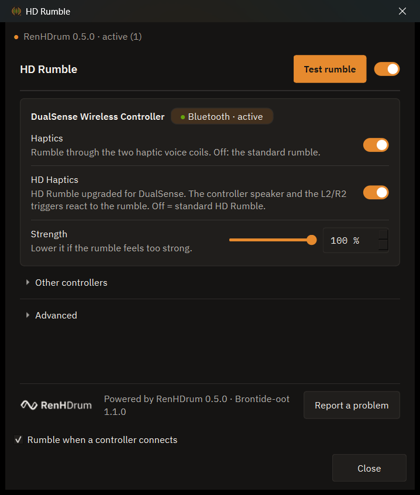
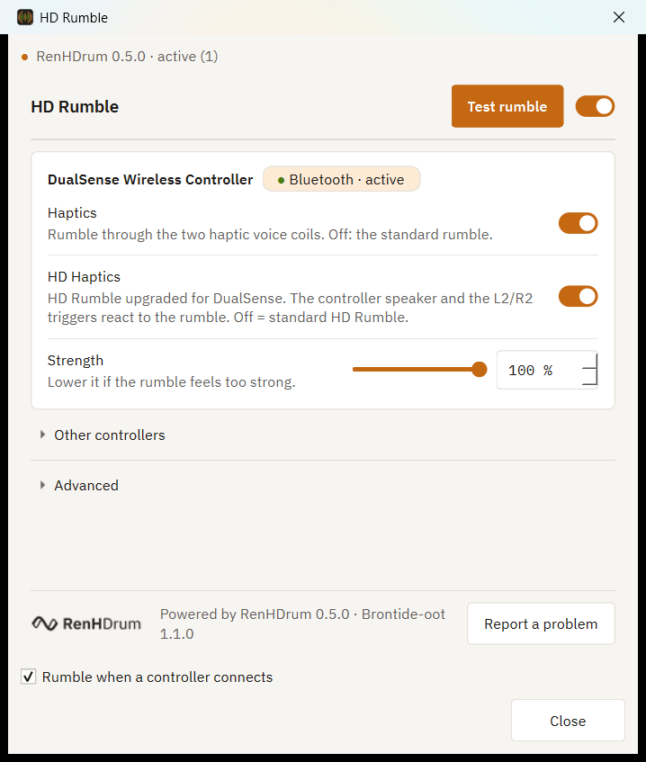
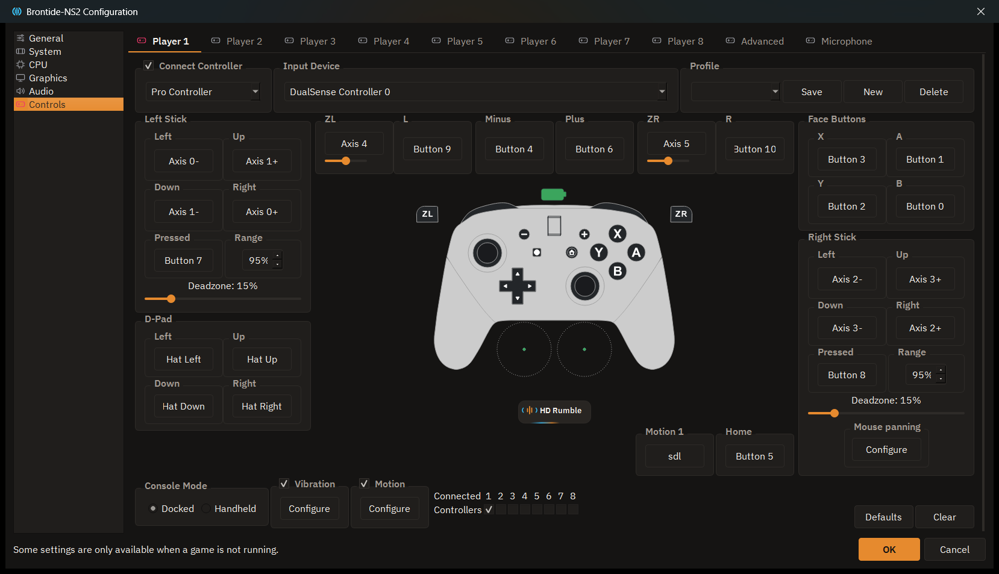
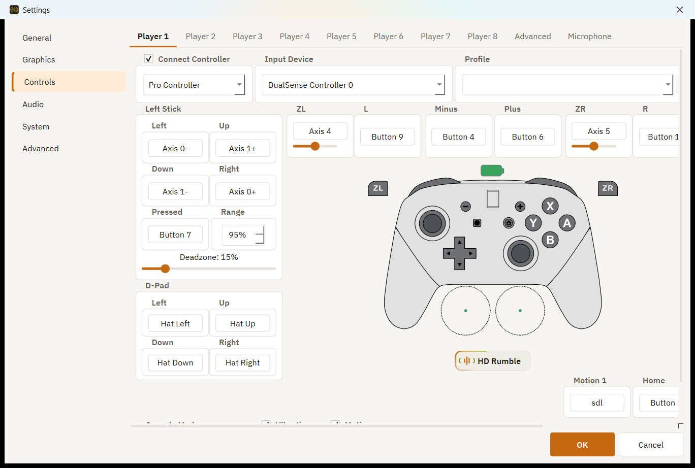

# HD Rumble settings: UI guidelines for hosts

How an emulator or PC port that uses RenHDrum should show its HD Rumble settings, so players see the same thing everywhere. Draw it with your own toolkit (Qt, Dear ImGui, …) and your own theme; only the structure, names, defaults and help text are fixed here. Ready-made code: `integrations/qt/` (Qt Widgets). The list of settings comes from the core at run time (`renhdrum_options`, see `c-abi-reference.md`), so a new core version can add a row without a host rebuild.

## 1. Where it lives
- Qt emulators (Eden family): a **HD Rumble…** button in Controls > Vibration opens the dialog.
- In-game menus (recomps, F1 overlay): a section titled **HD Rumble** inside the Controls tab; Advanced as a collapsible part of it.
- Credit line at the bottom: **Powered by RenHDrum** (link to the repo), with the core version if you show versions.

## 2. Page layout (top to bottom)
1. **HD Rumble** on/off switch (the master switch), and a **Test rumble** button.
2. **The controller in use**: one card, name + link ("USB" / "Bluetooth") + its basic settings (table 3). Nothing connected: one line, *"Connect a controller to see its settings."* Do not show an empty panel.
3. **Other controllers**: collapsed. Opening it shows the cards of the other families, so players can set them before plugging in.
4. **Advanced**: collapsed. All Advanced rows, grouped by controller then by link (Wired / Bluetooth). First row: **Recommended ✓** when every value is the recommended one, otherwise **Custom** with a **Reset to recommended** button.
5. Footer: credit line, **Report a problem** if the host has one.

Rules:
- Master switch off: everything below is greyed out, controllers use the host's standard rumble.
- A row that only works on one link (USB or Bluetooth) is shown only when the controller in use is on that link; in Other controllers / Advanced it stays visible but greyed, with *"Not in use: the controller is connected by {link}."*
- Changes apply on the next vibration; no game restart. If one setting does need a restart, say so on that row.
- No internal names on screen (token bucket, FormatThree, 0x36, envelope…). Use the labels below.
- One rule for every game: no per-game rumble settings.
- If the host has its own "accurate vibration" or rumble-rate filter that drops packets closer than 15 ms, keep it on (and greyed) while HD Rumble is on.

## 3. Basic settings (shown on the card of the controller in use)
| Key | Controller | Label (EN) | Label (VI) | Values | Default | Help text (EN) |
|---|---|---|---|---|---|---|
| `enable_hd_rumble` | all | HD Rumble | HD Rumble | on / off | on | Plays the game's HD Rumble in full detail. Off: the standard rumble. |
| `switch_bt_mode` | Switch Pro, Joy-Con (Bluetooth only) | Bluetooth mode | Chế độ Bluetooth | Detailed (5 ms) / Compatible | Detailed (5 ms) | Detailed (5 ms): every detail, like wired. Compatible: works on every Bluetooth adapter; used automatically when Detailed cannot run. |
| `dualsense_haptics` | DualSense, DualSense Edge | Haptics | Rung xúc giác | on / off | on | Rumble through the two haptic voice coils. Off: the standard rumble. |
| `dualsense_hd_haptics` | DualSense (USB; Bluetooth: rumble + triggers) | HD Haptics | HD Haptics | on / off | on | HD Rumble upgraded for DualSense. The controller speaker and the L2/R2 triggers react to the rumble. Off = standard HD Rumble. |
| (host setting) | DualSense | HD Triggers | Cò HD | on / off | on | The triggers follow the game (Tier 2 presets via `renhdrum_trigger_preset_*`). Off = the HD Haptics triggers (Tier 1). Show only when HD Haptics is on, or leave it visible and ignore it while HD Haptics is off. Only meaningful when the game has a game-state trigger layer (such as Longshot's `oot_trigger.c`). Not in the core table: the host keeps it (suggested key `hd_triggers`). |
| `dualsense_volume` | DualSense | Strength | Độ mạnh | 10–100 % | 100 % | Lower it if the rumble feels too strong. |
| `xbox_enabled` | Xbox and Xbox-style | HD Rumble on Xbox | HD Rumble cho Xbox | on / off | on | The game's HD Rumble translated for the Xbox motors. Off: the standard rumble. |
| (host setting) | official Xbox with trigger motors | Trigger rumble | Rung cò | on / off | off | Lets the two trigger motors join in. Show only when the controller has them; if the host needs its own setting turned on first (Eden: XInput 8 player support), show a one-click **Turn it on** next to it. Not in the core table. |
| (status only) | Steam Controller (2026) | Grips · Experimental | Báng cầm · Thử nghiệm | — | — | Follows the master switch. If rumble stops, close Steam or reconnect the controller. |

## 4. Advanced settings
| Key | Controller | Label (EN) | Values | Default |
|---|---|---|---|---|
| `gain` | all | Intensity | 25–1000 % | 100 % |
| `low_boost` | all | Lift weak rumble | 0–100 % | 0 % |
| `usb_no_queue` | Switch, wired | Send rumble without queuing | on / off | on |
| `envelope_5ms` | Switch, wired | Detailed 5 ms rumble | on / off | on |
| `frequency_in_packet` | Switch, wired | Accurate pitch, low band | on / off | on |
| `frequency_both_bands` | Switch, wired | Accurate pitch, both bands | on / off | on |
| `crisp_notes` | Switch, wired | Accent each note | on / off | on |
| `usb_interval_ms` | Switch, wired | Send interval (when detailed rumble is off) | 10 / 15 / 20 / 30 ms | 15 ms |
| `usb_auto_slow` | Switch, wired | Slow down during heavy rumble | on / off | recommended preset |
| `bt_after_input` | Switch, Bluetooth | Send rumble between button reads | on / off | on |
| `bt_crisp_notes` | Switch, Bluetooth | Accent each note | on / off | on |
| `dualsense_crisp_notes` | DualSense | Accent each note | on / off | on |
| `xbox_mode` | Xbox | Mode | RenHDrum / Direct | RenHDrum |
| `xbox_strength` | Xbox (both modes) | Motor strength | 0–1000 % | 100 % |
| `xbox_detail`, `xbox_accents`, `xbox_trigger_mix` | Xbox (Direct mode only) | Detail on main motor, Hit accents, Trigger rumble | 0–100 % | 50 / 50 / 20 % |

The exact keys, ranges and defaults are the ones `renhdrum_options` returns; this page follows them. Never rename a key after a release (saved settings would be lost).

## 5. Don't
- Don't put every controller's settings in one flat list.
- Don't make Compatible the Bluetooth default; Detailed falls back to it by itself.
- Don't add per-game rumble settings or per-game intensity.
- Don't hard-code colours in the dialog; inherit the host theme. Help text = the theme's text colour slightly lighter (about 70 % opacity), never the theme's "mid" grey: it is unreadable on dark themes.

## 6. RenHDrum identity (logo and credit line)
- **Where.** The RenHDrum wave mark and wordmark go in the settings panel itself (header or footer), next to the credit line **Powered by RenHDrum** (link to the repo, core version if you show versions). Keep it small: the panel is the host's, the logo only says where the rumble comes from.
- **Variants.** Use the files in `integrations/qt/brand/logo/` (light and dark). Pick the one that reads on your panel's background; do not recolour.
- **Size.** About 18 px high in a footer; text next to it at roughly 70 % opacity of the theme's text colour.
- Keep clear space around the logo at least the height of the capital letters (`RenHDrum` wordmark height).
- Never stretch, skew, recolour outside the provided variants, or separate the wordmark from the wave mark.
- No game covers and no controller maker logos or product photos in the panel or in screenshots you publish.

### What it looks like
The HD Rumble panel (dark and light), as drawn by the Qt sample in `integrations/qt/` inside Brontide-NS2: the controller in use first, Other controllers and Advanced collapsed, the logo and credit line at the bottom.

The entry point is the **HD Rumble** button on the Controls page. It sits below the controller picture and has a glowing outline so players can find it, without covering the stick test circles:

## 7a. "Test" button

I suggest a "Test" button on the controller card. It calls `renhdrum_demo_sample` (`c-abi-reference.md`, section 5e) on every tick the host already has: keep the press time, pass `now - start` in milliseconds, send both sides to the same sink the game's rumble uses, and stop when it returns `0`. Use `RENHDRUM_DEMO_QUICK_PING` ("which pad is this slot", left then right) as the default and `RENHDRUM_DEMO_TECH_SHOW` for a longer check of the low and high bands. The button needs no state in the core, so pressing it twice just restarts the clock.

## 7. In practice

- **Longshot (in-game menu in its own DLL).** The HD Rumble switch sits in Controls with a row that opens the HD Rumble page: Status line, Basic rows, Advanced rows behind a "Show" button, Reset, credit line. The page declares its rows by `renhdrum_options` key and reads each value back from the host every time it opens. The menu reaches the core through one host function, `rh_option` (get, set, reset, status, key name by index), so the menu DLL never links the bridge; it checks the host table version first. Rows that only apply to one link (for example Switch Bluetooth) hide themselves when a DualSense is connected by cable. Details: `recomp-games.md`, section 11, lesson 6.
- **totk-pc-recomp, dkb-pc-recomp and mkw-recomp.** The main HD Rumble switch is kept in the game's settings file (in the Controls tab / F1 menu); per-controller details are rendered from `rh_option_*` and saved in `renhdrum.ini` beside the executable.
- **Status text.** The status line comes from the bridge (`rh_status_line`). If a host hides rows by link, it has to match the bridge's wording, so keep that match in one place and test it.
- **Saved twice.** If the host menu also saves each keyed row in its own settings file, that is fine as long as loading the file never pushes values into the core; only a change by the player should.
