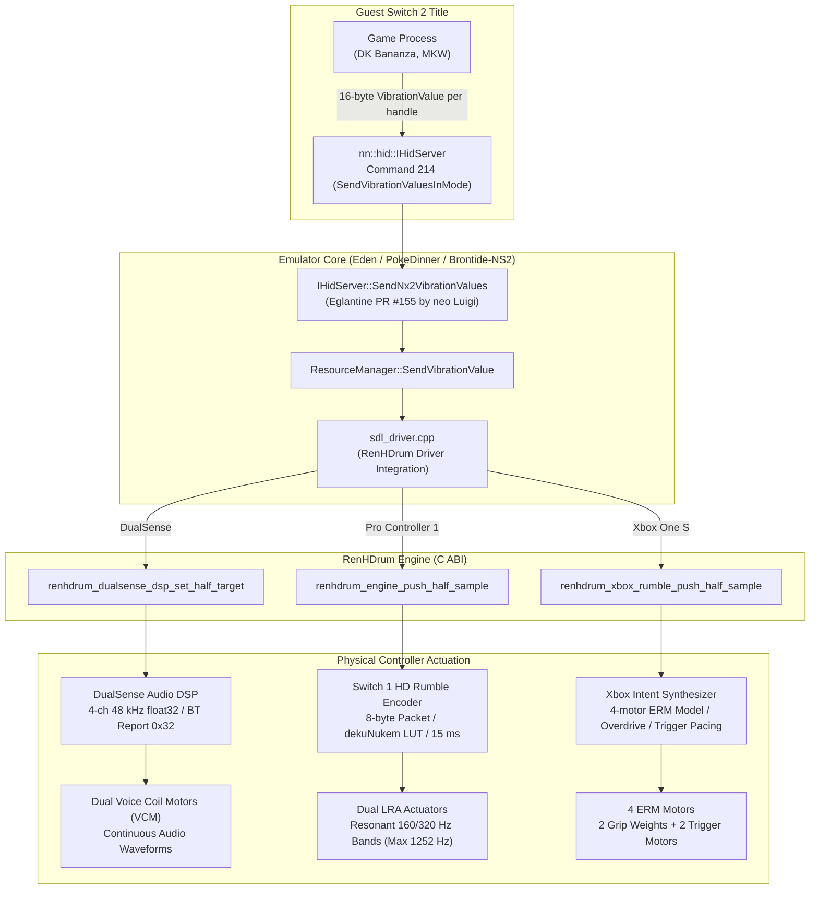

# Monograph 11: Switch 2 HD Rumble — Signal Path, Commands, and Emulation Realities

As far as we know, the Switch 2 console has no official DualSense support. On PC, however, a wired DualSense is currently the most expressive controller for playing Switch 2 games with HD Rumble, reproducing high-definition transients through dual voice coil motors (VCM) driven by continuous audio-rate waveforms.

This monograph documents how Switch 2 titles generate vibration requests, how those requests travel across the IPC boundary in early emulators, how RenHDrum routes the signal to three distinct controller architectures, the root cause of the infamous "2000 ms hanging rumble" in early test builds, and current hardware limitations.

> [!IMPORTANT]
> **Status: qualitatively verified in gameplay A/B testing.** Vibration behavior was verified across two retail Switch 2 titles (Donkey Kong Bananza and Mario Kart World) using three controller families (DualSense, Switch Pro Controller 1, and Xbox One S), toggling HD Rumble on/off mid-game. Quantitative measurements (precise Hz and ms timing for Switch 2 games) have not yet been recorded and will follow in future research. Command layouts are cross-referenced with Switchbrew wiki documentation, public emulator pull requests, and published patent applications. All unverified hypotheses are explicitly tagged.

---

## 1. What Switch 2 Games Actually Send

Marketing materials for "HD Rumble 2" emphasize next-generation haptics with wideband frequency response and high-dynamic-range actuators. However, reverse engineering of the guest OS interface reveals that **retail games continue to send vibration as two frequency-and-amplitude bands per actuator**, exactly as they did on Switch 1.

The primary evolution is in the physical controller hardware (wideband linear resonant actuators, 10-bit quantization fields, and independent sub-sample packet streaming up to 3500 Hz), rather than an immediate architectural shift to raw PCM audio streaming in games.

### 1.1 IPC Vibration Commands (`nn::hid::IHidServer`)

Through OS version 23.0.1, the system exposes three key vibration commands on the `nn::hid::IHidServer` IPC interface:

| Command ID | Name (Switchbrew) | Introduced | Arguments & Structure | Status in Emulators |
|---|---|---|---|---|
| **214** | `SendVibrationValuesInMode` | 17.0.0+ | Pointer buffers of `VibrationDeviceHandle` (4 bytes each) and `VibrationValue` (16 bytes each), plus raw `0x10` metadata containing a 64-bit `Mode` flag and Applet Resource User ID (`aruid`). | **Active**. Emulators (Brontide-NS2 based on PokeDinner 2.5.0, via Eglantine PR #155) map handles to values and pass them down. |
| **213** | `SendVibrationValueInMode` | 17.0.0+ | Single-handle per-call layout. Raw `0x20` payload containing device handle, 64-bit `Mode`, 16-byte `VibrationValue`, and `aruid`. | **Stubbed**. Unhandled in early builds; titles relying on 213 produce no vibration until implemented. |
| **220** | `IsOunceVibrationDeviceMounted` | 20.0.0+ (Switch 2 only) | Returns a 1-byte boolean indicating whether a native Switch 2 ("Ounce") controller is attached. | **Returns 0**. Indicates no native Switch 2 pad is present. May influence title fallback logic. |

### 1.2 The 16-Byte `VibrationValue` Struct

Each `VibrationValue` sent via command 214 uses the identical 16-byte structure established on Switch 1:

```cpp
struct VibrationValue {
    float amp_low;   // Low-band amplitude [0.0f, 1.0f]
    float freq_low;  // Low-band frequency (Hz, typically 40-400 Hz)
    float amp_high;  // High-band amplitude [0.0f, 1.0f]
    float freq_high; // High-band frequency (Hz, typically 400-1252 Hz)
};
```

Retail titles such as Donkey Kong Bananza and Mario Kart World dispatch command 214 with one sample per handle. Because the signal is dispatched in parametric form (amplitude + frequency), an emulator captures the **complete physical intent** of the sound designers. The remaining engineering challenge is how accurately each PC controller can reproduce that intent.

### 1.3 The `Mode` Flag

Command 214 includes a 64-bit parameter labeled `unknown` in early reverse engineering, confirmed as `Mode`:
- In Mario Kart World captures, `Mode` is set to `2`.
- In backward-compatible Switch 1 execution, `Mode` is typically `0`.

*[Unverified Hypothesis]*: `Mode == 0` designates vibration curves tuned for first-generation HD Rumble (LRA tuned for 160 Hz / 320 Hz resonance), while `Mode == 2` designates wideband HD Rumble 2 parameters. On native hardware, the OS may use this flag to apply equalization curves when driving a legacy Pro Controller 1.

### 1.4 Why No PCM Commands Exist

Patent filings (e.g. US 20260295388–91) describe four theoretical playback modes for HD Rumble 2: parametric amplitude/frequency packets (5 ms slots), continuous PCM streaming (20 ms blocks at 8 kHz), pre-loaded onboard PCM waveforms, and autonomous controller-driven playback triggered by sensor thresholds.

However, as of late 2026, **no public IPC command exists for streaming PCM to controllers**. All examined retail games rely exclusively on parametric command 214. Consequently, a trace tap placed at the emulator's vibration boundary captures 100% of the game's transmitted haptic output.

---

## 2. Signal Routing Architecture

In an emulator equipped with RenHDrum (such as Brontide-NS2), vibration values flow from the guest game process directly to physical PC gamepads through dedicated low-latency pipelines:



---

## 3. Reproduction Fidelity by Controller Architecture

No physical controller reproduces the Switch 2 signal identically to native Joy-Con 2 hardware. Each architecture makes specific trade-offs:

| Controller | Reproduction Method | Preserved Fidelity | Hardware & Protocol Constraints |
|---|---|---|---|
| **PlayStation 5 DualSense** | Onboard DSP synthesizes dual sine waves at 48 kHz (wired USB) or HID report `0x32` at 3 kHz (Bluetooth), driving stereo voice coils. | **Highest**. Pitch and amplitude remain fully continuous and can modulate per millisecond. Clean attack transients and distinct musical textures. | Power ceiling set to 0.70 to protect coils. High-frequency ceiling on Bluetooth (~1.5 kHz) is lower than wired USB. |
| **Switch Pro Controller 1** | Encoded into legacy Switch 1 8-byte sub-command `0x10` packets via the 101-threshold dekuNukem LUT. 15 ms transmission framing. | **Native Switch 1 feel**. Correct resonant vibration for classic Switch tactile design. | Clamped to 1252 Hz ceiling. High frequencies far from 160/320 Hz resonant peaks feel attenuated on first-gen LRAs. |
| **Xbox One S (Model 1708)** | Four eccentric rotating mass (ERM) motors driven by the RenHDrum heuristic translator (`rawinput` / WGI). | **Rhythmic & directional envelope**. Distinct trigger taps for impacts, separate left/right grip rumble, smooth decay. | **No pitch reproduction**. Frequency is physically tied to motor rotation speed; cannot play audio-rate chords or subtle pitch glides. |
| **Joy-Con 2 / Pro Controller 2** | Native 10-bit sub-sample encoding. | *Not yet supported in RenHDrum*. | Requires dedicated 10-bit encoder and HIDAPI transport layers for native Switch 2 accessories. |

---

## 4. The 2000 ms Hanging Rumble Bug in Legacy Emulators

Prior to integrating RenHDrum, testers of early Switch 2 emulator branches reported a frequent and disruptive defect: controllers would begin vibrating during an action or loading transition and **continue vibrating loudly for several seconds** without stopping (documented in Eglantine Issue #513).

### 4.1 Root Cause in Generic SDL Fallbacks

In vanilla PokeDinner and early Eglantine branches, the vibration fallback path in `sdl_driver.cpp` simply called:

```cpp
SDL_RumbleGamepad(joystick, low_freq_intensity, high_freq_intensity, 2000);
```

This produced two critical failure modes:
1. **Total Frequency Loss**: All spectral information was discarded; motors spun at fixed rates regardless of whether the game signaled a high metal chime or a low engine idle.
2. **2-Second Hold Duration**: Every invocation requested a 2000 ms duration from the SDL driver. Switch 2 games frequently stop vibrating simply by **ceasing to transmit commands**, rather than sending an explicit zero-amplitude packet `(0.0f, 0.0f, 0.0f, 0.0f)`. For instance, when Donkey Kong Bananza freezes the render thread during level transitions, the command stream halts immediately. The gamepad driver, having received a 2000 ms duration request on the last active frame, kept the motors spinning until the 2-second timeout expired.

### 4.2 How RenHDrum Eliminates the Bug

RenHDrum decouples guest IPC dispatch from physical hardware actuation:
- **Idle Watchdogs**: Independent watchdog timers monitor incoming sample intervals on each channel. If sample delivery ceases without an explicit zero, the engine decays amplitude to silence within a controlled decay window.
- **Micro-Cadence Generation**: Output packets to the hardware are scheduled at precise physical intervals (15 ms for USB Pro Controller, 10.67 ms for Bluetooth DualSense, 10-20 ms for Xbox). When the incoming queue dries up, neutral silence packets are immediately dispatched, terminating motor drive without lingering vibrations.

---

## 5. Current Hardware & Emulation Limits

When testing Switch 2 vibration on current emulator builds, the following limitations must be noted:

1. **Tested Titles Only**: Empirical verification is currently limited to **Donkey Kong Bananza** and **Mario Kart World**. Other commercial games may employ different pacing or alternative command sequences.
2. **Command 213 is a Stub**: Titles that issue vibration calls exclusively through command 213 (suspected in early tests of Kirby Air Riders) will remain silent until command 213 is routed to the resource manager.
3. **Literal Frequency Clamping on Pro Controller 1**: In the current RenHDrum pipeline, any high-band frequency exceeding 1252 Hz is clamped directly to 1252 Hz. While safe, first-generation LRA actuators deliver very little mechanical power above 400 Hz. A perceptual compression curve (mapping high-frequency intent to lower resonant bands) is not yet enabled.
4. **Early Emulation Performance**: Switch 2 emulation is in its inception. Titles such as Mario Kart World run at approximately 40 FPS on standard desktop configurations (e.g. Intel Core i5-12400F with NVIDIA GeForce RTX 4060). Frame drops or CPU stalls can cause temporary jitter in sample pacing.

---

## 6. What We Are Researching Next

Active research in RenHDrum and the Brontide testbed is focused on four areas:

1. **Full Command 213 Implementation**: Complete the handler for `nn::hid::IHidServer` command 213 in the HLE service layer, allowing games with per-controller single-handle layouts to vibrate.
2. **Vibration Trace Logging for Switch 2**: Expand the unified trace recording mechanism (`hdrumble_trace.txt`) across all three output backends to capture the exact arrival cadence, frequency histograms, and `Mode` flags of commercial Switch 2 titles.
3. **Wired DualSense High-Frequency Expansion**: The DualSense 48 kHz audio pipeline is theoretically capable of reproducing acoustic vibrations beyond 1252 Hz. Once trace data confirms games emit frequencies in the 1200–3500 Hz range, the synthetic frequency clamp can be widened on wired connections.
4. **Equalization Curves for Pro Controller 1**: Implement an optional "perceptual translation" switch based on Nintendo patent publications (JP 2026015701–03 curves Ln1–Ln4) that remaps high-frequency energy down to the 160/320 Hz resonant sweet spots of first-generation LRAs, allowing A/B comparison against literal clamping.

---

## References & Credits

- **neo Luigi**: Implementation of genuine command 214 dispatching in Eglantine PR #155 (`2b413a46a2`, `465aa33077`).
- **Franseven**: Author of PokeDinner 2.5.0 (`216b5034c6`), the baseline Switch 2 emulator testbed.
- **Switchbrew Wiki**: Documentation of `nn::hid::IHidServer` IPC commands 213, 214, and 220.
- **Nintendo Co., Ltd.**: Published patent applications US 20260295388–91 (haptic feedback modes) and JP 2026015701–03 (equalization between hardware generations).
- **RenHDrum / Brontide Team**: Physical multi-controller DSP routing, idle watchdog architecture, and Xbox One intent translation.
