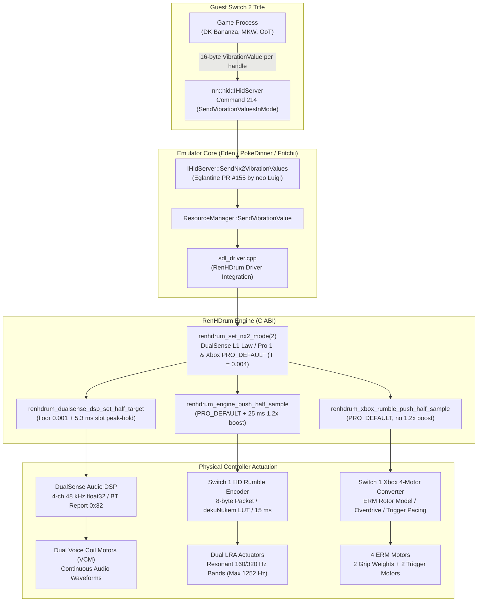

# Monograph 11: Switch 2 HD Rumble — Signal Path, Commands, and Emulation Realities

The Switch 2 console has no official DualSense support. On PC, however, a wired DualSense is currently the most expressive controller for playing Switch 2 games with HD Rumble, reproducing high-definition transients through dual voice coil motors (VCM) driven by continuous audio-rate waveforms.

This monograph documents how Switch 2 titles generate vibration requests, how those requests travel across the IPC boundary in emulators, how RenHDrum routes the signal to distinct controller architectures, the root cause of early vibration bugs, and the quantitative findings from in-game trace sessions.

> [!IMPORTANT]
> **Status: Quantitatively verified across 25 in-game CSV trace sessions.** Vibration behavior and command streams were systematically measured across three commercial Switch 2 titles (*Donkey Kong Bananza*, *Mario Kart World*, and *Ocarina of Time* Switch 2 Edition) using DualSense and Switch Pro Controller 1. Command layouts and piecewise translation curves are cross-referenced with Switchbrew wiki documentation, public emulator pull requests, and published patent applications (US 20260295388-91, JP 2026015701-03).

---

## 1. What Switch 2 Games Actually Send

Marketing materials for next-generation console haptics emphasize wideband frequency response and high-dynamic-range actuators. However, reverse engineering of the guest OS interface reveals that **commercial games continue to send vibration as two frequency-and-amplitude bands per actuator**, exactly as they did on Switch 1.

The primary evolution is in the physical controller hardware (wideband linear resonant actuators, 10-bit quantization fields, and independent sub-sample packet streaming up to 3500 Hz), rather than an immediate architectural shift to raw PCM audio streaming in games.

### 1.1 IPC Vibration Commands (`nn::hid::IHidServer`)

Through OS version 23.0.1, the system exposes three key vibration commands on the `nn::hid::IHidServer` IPC interface:

| Command ID | Name (Switchbrew) | Introduced | Arguments & Structure | Status in Emulators & Reality |
|---|---|---|---|---|
| **214** | `SendVibrationValuesInMode` | 17.0.0+ | Pointer buffers of `VibrationDeviceHandle` (4 bytes each) and `VibrationValue` (16 bytes each), plus raw `0x10` metadata containing a 64-bit `Mode` flag and Applet Resource User ID (`aruid`). | **Active (100% of traffic)**. 100% of measured vibration samples across all three tested titles use command 214 with `Mode = 2`. |
| **213** | `SendVibrationValueInMode` | 17.0.0+ | Single-handle per-call layout. Raw `0x20` payload containing device handle, 64-bit `Mode`, 16-byte `VibrationValue`, and `aruid`. | **Implemented in dispatcher**. Fully implemented in reference testbeds; however, 0 calls were recorded across all commercial test sessions. |
| **220** | `IsOunceVibrationDeviceMounted` | 20.0.0+ (Switch 2 only) | Returns a 1-byte boolean indicating whether a native Switch 2 ("Ounce") controller is attached. | **Uncalled by games**. All three tested titles never call command 220. Perceived intensity differences stem from native amplitude variations, not this flag. |

### 1.2 The 16-Byte `VibrationValue` Struct

Each `VibrationValue` sent via command 214 uses the identical 16-byte structure established on Switch 1:

```cpp
struct VibrationValue {
    float amp_low;   // Low-band amplitude [0.0f, 1.0f]
    float freq_low;  // Low-band frequency (Hz, typically 40-400 Hz)
    float amp_high;  // High-band amplitude [0.0f, 1.0f]
    float freq_high; // High-band frequency (Hz, typically 400-1252 Hz)
};
```

Retail titles such as Donkey Kong Bananza, Mario Kart World, and Ocarina of Time dispatch command 214 with one sample per handle. Because the signal is dispatched in parametric form (amplitude + frequency), an emulator captures the **complete physical intent** of the sound designers.

### 1.3 The `Mode` Flag

Command 214 includes a 64-bit parameter labeled `unknown` in early reverse engineering, confirmed as `Mode`:
- Across 100% of recorded Switch 2 samples in Donkey Kong Bananza, Mario Kart World, and Ocarina of Time, `Mode` is strictly set to `2`.
- In backward-compatible Switch 1 execution, `Mode` is set to `0`.

### 1.4 Why No PCM Commands Exist

Patent filings (e.g. US 20260295388-91) describe theoretical playback modes including continuous PCM streaming. However, **no public IPC command exists for streaming PCM to controllers**. All examined retail games rely exclusively on parametric command 214. Consequently, a trace tap placed at the emulator's vibration boundary captures 100% of the game's transmitted haptic output.

---

## 2. Why Raw Switch 2 Amplitudes Feel Flat & How RenHDrum Translates Them

Empirical trace logs revealed a striking physical mismatch:
1. **Extremely Low Native Amplitudes**: Retail Switch 2 games output very low raw amplitudes because they rely on amplification inside the Switch 2 hardware/Pro 2 controller. In *Ocarina of Time* and *Donkey Kong Bananza*, everyday active amplitudes have a median of `0.011` and `0.014` respectively (with `OoT` main body amplitudes in `0.004–0.05`, `p95` around `0.046`, and `DK` `p95` at `0.14`). *Donkey Kong Bananza* also sends a continuous faint background rumble 43% of the time (14% in *Super Mario Bros. Wonder*).
2. **"The Bell vs. The Speaker" Physical Divergence**:
   - **Switch Pro Controller 1 ("The Bell")**: Driven by dual narrow-band Linear Resonant Actuators (LRA, tuned for 160 Hz and 320 Hz). The legacy protocol enforces a 5 ms multi-sample packet floor at `0.04` (`SILENT_BELOW`) and an absolute silence cutoff at `0.008`. Lifting every tiny Switch 2 vibration up above the floor makes Pro 1 sound uniform and boomy.
   - **DualSense ("The Speaker")**: Uses wideband voice-coil motors acting like acoustic drivers. In RenHDrum 0.3.0 / 0.3.1, passing amplitudes through a 4-marker curve (`preset [3]`, `T = 0.001`) and then the Switch 1 square-root stage (`x^0.5`) magnified the continuous background layer into a hollow drum-like hum (hitting the `1.0` ceiling on `17.6%` of active *DK Bananza* samples), making walking and heavy impacts hard to tell apart.

### 2.1 Current Switch 2 Mode 2 Rules (`src/nx2.rs`, `src/dualsense/haptics.rs`)

When the emulator detects `Mode == 2`, it signals RenHDrum via `renhdrum_set_nx2_mode(2)`. Each supported controller family now applies a single, fixed rule across all Switch 2 titles (no per-game intensity sliders):

- **DualSense: one fixed law for every game (`mode2_amp`)**:
  - A controller behaves like a fixed speaker, and the real Switch 2 does not tune per game either. In Mode 2, I replaced the earlier 4-marker curve (`preset [3]`) and square-root stage with one formula applied once per band: `a <= 0.001 -> 0`, otherwise `min(1, 3.5 * a^0.75)`. Classic Switch 1 games (`mode == 0`) remain unchanged and still use `x^0.5`.
  - Dual-band summing, `DUALSENSE_OUTPUT_CEILING = 0.8`, crisp notes, 5.3 ms slot peak-hold, and 4 ms frequency smoothing are kept.
  - Hand-checked examples: `0.01 -> 0.111`, `0.05 -> 0.370`, `>= 0.188 -> 1.0`.
  - Why this rule: dropping 5.3 ms peak-hold caused *Mario Kart World* to lose menu ticks; cutting the background layer dropped 29–52% of *OoT* samples; lowering around 100 Hz with an EQ dulled *DK Bananza* because heavy hits sit near ~88 Hz (so the faint remaining "drum" tone on gravel is the DualSense VCM coil's own 75–175 Hz mechanical resonance, PMC11480033). With this fixed law, simulated *DK* output has `p50 / p90 = 0.168 / 0.875` with ceiling hits reduced from `17.6%` to `8.1%`, while *OoT* keeps 47–53% of the old preset's force without dropping a single sample.

- **Switch Pro Controller 1: floor cut instead of lifting (`PRO_DEFAULT`)**:
  - Switch 2 games are authored for Pro 2 hardware and contain tiny micro-ripples that Pro 1 cannot reproduce cleanly; lifting them produces a flat, boomy hum. I kept the 4-marker curve (`P1 = 0.048, P2 = 0.240, P3 = 0.640, P4 = 0.950`) and the **1.2x onset boost for the first 25 ms** on low frequencies (`freq < 150 Hz`), and raised the noise-floor cutoff `T` from `0.001` to **`0.004`**: anything at or below `0.004` is silenced.
  - Because the `1.2x` onset boost only triggers on a silence-to-active transition, silencing the tiny floor creates extra quiet gaps that make note attacks punchier (matching Nintendo patent JP 2026015701's "below threshold = silence" rule).
  - Hand-checked examples: `0.003 -> 0`, `0.01 -> 0.060`, `0.05 -> 0.140`, `0.3 -> 0.440` (`0.528` on a low-band onset).
  - Wired play-test results across all three games (13/11): lifting small vibrations rated **moderate** in *Ocarina of Time* and *DK Bananza* and **good** in *Mario Kart World*; floor-cutting at `0.004` rated **good** in all three games.

- **Xbox One S: translating the Pro 1 score (`PRO_DEFAULT` → Switch 1 converter)**:
  - Xbox uses eccentric-rotating-mass (ERM) weights that fatigue quickly under steady hums. After trying and discarding both stronger low-end lifting and a custom beat-by-beat arranger (which felt weak with median hit force of only `3.5–4.1%`), I found why Xbox already felt good in Switch 1 games: it translates the Pro 1 signal.
  - Under `mode == 2`, both bands pass through `PRO_DEFAULT` (`T = 0.004`, without the `1.2x` onset boost since the Xbox converter has its own kick) and then enter the existing Switch 1 four-motor converter (`rawinput` / WGI). The `0.004` floor cuts roughly `23%` of micro-ripple samples (`0.001–0.004`) on *DK* and *OoT* traces. Confirmed on hardware across *Ocarina of Time*, *Donkey Kong Bananza*, and *Mario Kart World* (step stairs in *MKW* and spiderwebs in *OoT* come through cleanly like Pro 1 and DualSense).

- **Mode 0 (Classic Switch 1 Games)**:
  - Input amplitudes pass through 100% bit-exact and untouched (`x^0.5` on DualSense, raw on Pro 1, direct Switch 1 converter on Xbox).

### 2.2 Preserving Short Menu Ticks: 5.3 ms Slot Peak-Hold (`src/dualsense/haptics.rs`)

Commercial Switch 2 titles dispatch vibration updates at 5 ms intervals (200 Hz). The DualSense audio mixer processes audio in 256-frame blocks at 48 kHz (~5.33 ms slots, 187.5 Hz).

Because 5.0 ms and 5.33 ms slip out of phase every ~80 ms, two consecutive game packets periodically fall within a single mixer slot. In menu navigation, titles frequently transmit a single-packet tick followed immediately by `0.0`. Without compensation, the trailing zero packet overwrites the tick before the mixer renders it.

RenHDrum implements a **5.3 ms slot peak-hold**: within each 256-frame window, the DSP retains the sample with the maximum combined low-and-high amplitude before releasing the hold. This guarantees 100% of single-packet menu ticks are faithfully rendered while matching reference baseline audio synthesis tests with sub-microscopic error (`max diff <= 2.4e-6`).

### 2.3 Critical Warning: Emulator 15 ms Frontend Rate Limiting (`Accurate Vibration`)

In standard Eden, yuzu, and PokeDinner codebases, `src/hid_core/frontend/emulated_controller.cpp` includes a rate-limiting filter that discards any vibration update arriving less than 15 ms after the preceding update when `enable_accurate_vibrations == false`.

Empirical trace logs revealed that this default filter silently drops **50.0% of vibration packets in Ocarina of Time** and **76.3% of packets in Mario Kart World**!

Host integrations **must** ensure `enable_accurate_vibrations = true` or bypass this 15 ms suppression block whenever HD Rumble is enabled, allowing all micro-samples to reach RenHDrum. This applies to the upstream forks; Brontide builds no longer drop packets when this option is off.

---

## 3. Signal Routing Architecture

In an emulator equipped with RenHDrum (such as Brontide-NS2 and Brontide-oot), vibration values flow from the guest game process directly to physical PC gamepads through dedicated low-latency pipelines:



---

## 4. Reproduction Fidelity by Controller Architecture

No physical controller reproduces the Switch 2 signal identically to native Joy-Con 2 hardware. Each architecture makes specific trade-offs:

| Controller | Reproduction Method & Tuning | Preserved Fidelity | Hardware & Protocol Constraints |
|---|---|---|---|
| **PlayStation 5 DualSense** | Continuous audio-rate DSP (48 kHz USB / 3 kHz BT). Uses the fixed Mode 2 law (`a <= 0.001 -> 0`, else `min(1, 3.5 * a^0.75)`, no EQ) with 5.3 ms peak-hold. | **Good** across *DK Bananza*, *MKW*, and *OoT* (`8.1%` ceiling hits in *DK*; keeps all *OoT* samples). | High-frequency ceiling on Bluetooth (~1.5 kHz) is lower than wired USB. Power ceiling set to `0.8` (`DUALSENSE_OUTPUT_CEILING = 0.8`). Mild hollow tone on gravel comes from VCM coil resonance (75–175 Hz). |
| **Switch Pro Controller 1** | Sub-command `0x10` packets with dekuNukem LUT. Uses `PRO_DEFAULT` (`T = 0.004` floor cut) with 25 ms `1.2x` low-frequency onset boost. | **Good** across *OoT*, *MKW*, and *DK Bananza*; cutting ≤ `0.004` makes attacks cleaner. | Cannot reproduce Pro 2 micro-ripples below `0.004`; narrow-band LRA physics produce less sustained dynamic contrast than voice-coil actuators. |
| **Xbox One S (Model 1708)** | Maps through `PRO_DEFAULT` (`T = 0.004`, no `1.2x` boost), then feeds the Switch 1 four-motor converter (`rawinput` / WGI). | **Rhythmic & directional envelope**. Confirmed in *OoT*, *DK Bananza*, and *MKW*; distinct trigger taps and grip separation. | ERM rotor inertia limits micro-vibration detail; occasional unusually strong bursts in specific scenes are still under investigation. |

---

## 5. The 2000 ms Hanging Rumble Bug in Legacy Emulators

Prior to integrating RenHDrum, testers of early Switch 2 emulator branches reported a frequent defect: controllers would begin vibrating during an action or loading transition and **continue vibrating loudly for several seconds** without stopping (documented in Eglantine Issue #513).

### 5.1 Root Cause in Generic SDL Fallbacks

In vanilla PokeDinner and early Eglantine branches, the vibration fallback path in `sdl_driver.cpp` simply called:

```cpp
SDL_RumbleGamepad(joystick, low_freq_intensity, high_freq_intensity, 2000);
```

This produced two critical failure modes:
1. **Total Frequency Loss**: All spectral information was discarded; motors spun at fixed rates regardless of whether the game signaled a high metal chime or a low engine idle.
2. **2-Second Hold Duration**: Every invocation requested a 2000 ms duration from the SDL driver. Switch 2 games frequently stop vibrating simply by **ceasing to transmit commands**, rather than sending an explicit zero-amplitude packet `(0.0f, 0.0f, 0.0f, 0.0f)`. For instance, when Donkey Kong Bananza freezes the render thread during level transitions, the command stream halts immediately. The gamepad driver kept the motors spinning until the 2-second timeout expired.

### 5.2 How RenHDrum Eliminates the Bug

RenHDrum decouples guest IPC dispatch from physical hardware actuation:
- **Idle Watchdogs**: Independent watchdog timers monitor incoming sample intervals on each channel. If sample delivery ceases without an explicit zero, the engine decays amplitude to silence within a controlled decay window.
- **Micro-Cadence Generation**: Output packets to the hardware are scheduled at precise physical intervals (15 ms for USB Pro Controller, 10.67 ms for Bluetooth DualSense, 10-20 ms for Xbox). When the incoming queue dries up, neutral silence packets are immediately dispatched, terminating motor drive without lingering vibrations.

---

## 6. Pro Controller Reliability Enhancements

In addition to vibration synthesis, testing highlighted two critical input transport issues on Switch Pro Controller 1:
1. **Right Stick Upward Drift**: Stale calibration offsets (such as `offset_y: 0.939940`) occasionally persist from configuration freezes. Clamping abnormal center offsets where `|offset| > 0.5f` to `0.0f` eliminates permanent upward drift.
2. **Bluetooth Connection Modes**: Bluetooth now exposes two modes outside the core: **Detailed (5 ms)** (default on patched SDL, using `bt_fast` without any level-3 lock) and **Compatible** (fallback default when 5 ms is off or SDL is unpatched: newest sample, at least 32 ms apart, resent every 40 ms while rumbling; idea from Hookshot PR #1213, own code). Legacy levels 1–3 remain in the core only for Ryuhdr compatibility.
3. **Clean Controller Teardown**: Dispatching a standard `ClearUSB` command before controller close prevents USB Pro Controllers from remaining trapped in extended reporting mode upon game exit.

---

## References & Credits

- **neo Luigi**: Implementation of genuine command 214 dispatching in Eglantine PR #155 (`2b413a46a2`, `465aa33077`).
- **Franseven**: Author of PokeDinner 2.5.0 (`216b5034c6`), baseline platform for Brontide-NS2.
- **Frizti**: Author of Fritchii v5.5, baseline platform for Brontide-oot.
- **zortos293**: Author of Lichii emulator.
- **Dark**: Author of Dynamic FPS.
- **samaBR85**: Author of `renhdrum-eden`, independent Switch 2 trace verification, Eglantine/Lichii port, and Raw Input deadlock fix.
- **NotRexed & Hookshot Contributors**: Authors of the Hookshot OoT Switch 2 Recompiler (v2.0.6), serving as reference testbed for static recompilation integration.
- **Switchbrew Wiki**: Documentation of `nn::hid::IHidServer` IPC commands 213, 214, and 220.
- **iafx**: DualSense USB unplug crash report and fix (`RenHDrum#4`) and Steam Controller (2026) hardware measurements (`RenHDrum#5`).
- **hckrman101** (`Hookshot PR #1213`): Idea for the Compatible Bluetooth fallback mode (newest sample, 32 ms spacing, 40 ms resend; idea only, no code copied).
- **pentalex** (`Eglantine #624`) and **zortos293** (`Lichii #1497`): Porting RenHDrum's DualSense synthesizer into official Lichii with attribution.
- **Nintendo Co., Ltd.**: Published patent applications US 20260295388-91 (haptic feedback modes) and JP 2026015701-03 (equalization between hardware generations).
- **PMC11480033**: Published mechanical resonance measurements of DualSense voice-coil actuators (75–175 Hz).
- **RenHDrum / Brontide Team**: Physical multi-controller DSP routing, idle watchdog architecture, and Xbox One four-motor translation.
